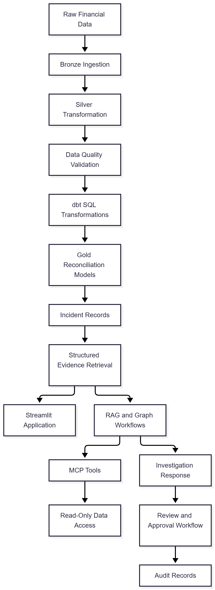

# FINRECON AI
### Intelligent Payment Reconciliation & Data Quality Platform with AI-Assisted Investigation

[](https://www.python.org/)
[](https://streamlit.io/)
[](https://duckdb.org/)
[](https://www.getdbt.com/)
[](https://www.langchain.com/langgraph)
[](https://modelcontextprotocol.io/)

FINRECON AI is a data engineering and AI-assisted investigation platform that processes financial transaction data, validates data quality, identifies payment reconciliation discrepancies, and retrieves supporting evidence for incident investigation.

It combines a layered data pipeline, SQL transformations, automated validation, reconciliation models, and an interactive Streamlit interface to demonstrate a structured approach to financial data reliability.

**Repository:** [Ayushisinhaxvii/finrecon-ai](https://github.com/Ayushisinhaxvii/finrecon-ai)

---

## Table of Contents

1. [Project Title](#1-project-title)
2. [Project Tagline and Description](#2-project-tagline--description)
3. [Badges](#3-badges)
4. [Table of Contents](#4-table-of-contents)
5. [Overview](#5-overview--introduction)
6. [Problem Statement](#6-problem-statement)
7. [Objectives](#7-objectives)
8. [Features](#8-features)
9. [Screenshots and Demo](#9-screenshots--demo)
10. [Tech Stack](#10-tech-stack)
11. [System Architecture](#11-system-architecture)
12. [Project Structure](#12-project-structure)
13. [Installation and Setup](#13-installation--setup)
14. [Environment Variables](#14-environment-variables)
15. [How to Run](#15-how-to-run)
16. [Usage Guide](#16-usage-guide)
17. [API Documentation](#17-api-documentation)
18. [Testing](#18-testing)
19. [Results and Output](#19-results--output)
20. [Limitations](#20-limitations)
21. [Future Enhancements](#21-future-enhancements)
22. [Contributing](#22-contributing)
23. [License](#23-license)
24. [Author and Contact](#24-author--contact)
25. [Acknowledgements and References](#25-acknowledgements--references)

---

## 1. Project Title

**FINRECON AI — Intelligent Payment Reconciliation & Data Quality Platform with AI-Assisted Investigation**

## 2. Project Tagline / Description

FINRECON AI helps organize financial data processing, validate transaction records, detect reconciliation discrepancies, and investigate incidents using structured evidence and AI workflow components.

The project demonstrates how data engineering practices can support more reliable and explainable financial reconciliation workflows.

## 3. Badges

The badges above identify the primary technologies used in the project. They are technology badges, not claims of a passing CI pipeline, published release, or production deployment.

- **Language:** Python
- **Database:** DuckDB
- **Transformations:** dbt and SQL
- **Interface:** Streamlit
- **AI workflows:** LangChain and LangGraph
- **Tool integration:** Model Context Protocol (MCP)

Automated GitHub Actions build status, release version, and license badges are not included because those configurations have not been established.

## 4. Table of Contents

Use the links above to navigate the documentation. Each section describes the project's purpose, implementation, setup, or current scope.

## 5. Overview / Introduction

Financial reconciliation involves comparing related records across payments, refunds, settlements, and orders. Differences between these records can indicate missing transactions, timing issues, incorrect amounts, or other exceptions requiring investigation.

FINRECON AI organizes this process into a modular data platform.

The system includes:

- A layered data processing pipeline.
- Dataset validation and data quality checks.
- SQL-based transformations using dbt.
- Reconciliation models and incident records.
- Structured incident evidence retrieval.
- AI-assisted investigation workflow components.
- An interactive Streamlit application.
- Review and audit workflow foundations.

The project is intended for learning, demonstration, and portfolio evaluation in data engineering and AI-assisted analytics. It is not a production financial application.

## 6. Problem Statement

Financial data often originates from multiple systems, each maintaining its own representation of orders, payments, refunds, and settlements.

Manual comparison can make it difficult to:

- Detect inconsistent or missing records.
- Validate data before downstream processing.
- Trace discrepancies to their supporting evidence.
- Repeat reconciliation checks consistently.
- Review investigation decisions and supporting records.

FINRECON AI addresses these challenges by organizing data processing, validation, reconciliation, and incident investigation into a structured workflow.

## 7. Objectives

The main objectives are to:

1. Build a modular data engineering pipeline for financial datasets.
2. Organize data into Raw, Bronze, Silver, and Gold processing stages.
3. Validate records using Python data contracts and SQL tests.
4. Transform financial datasets using dbt.
5. Identify payment and settlement discrepancies.
6. Retrieve structured evidence associated with incidents.
7. Explore RAG and graph-based workflows for AI-assisted investigation.
8. Expose selected data retrieval operations through MCP tools.
9. Present project functionality through a Streamlit interface.
10. Establish a review and audit foundation without automatically executing financial corrections.

## 8. Features

### Data ingestion and processing

- Raw-to-Bronze ingestion.
- Bronze-to-Silver transformation scripts.
- Change-detection and incremental-processing utilities.
- Backfill processing.
- Invalid-record quarantine utilities.

### Data quality

- Python data contracts for orders, payments, refunds, and settlements.
- Dataset validation scripts.
- Reconciliation status checks.
- dbt SQL tests for selected data quality rules.

### Reconciliation

- Processing of order, payment, refund, and settlement information.
- Gold-layer reconciliation models.
- Incident-oriented reconciliation outputs.
- Structured records for further investigation.

### Incident investigation

- Incident listing and status-count tools.
- Structured evidence retrieval.
- RAG and graph-workflow components.
- SQL and retrieval routing components.

### MCP integration

The repository includes MCP server implementations exposing read-only operations for selected reconciliation and incident data.

### Review and audit

- Approval workflow foundations.
- Review decision recording.
- Audit-oriented logging.
- Separation between reviewing a proposed action and executing a financial correction.

### Interactive application

The Streamlit application provides the interface for accessing project workflows. The exact behavior of each page depends on the local configuration and available data.

## 9. Screenshots / Demo

Screenshots of the actual application belong in the `screenshots/` folder at the project root.


## 10. Tech Stack

| Category | Technologies |
|---|---|
| Programming language | Python |
| Data processing | Pandas, NumPy |
| Analytical database | DuckDB |
| Query language | SQL |
| Data transformation | dbt |
| Data quality | Python validation scripts, dbt tests |
| User interface | Streamlit |
| AI orchestration | LangChain, LangGraph |
| Retrieval | RAG and vector search |
| LLM integration | Google Gemini API |
| Tool integration | Model Context Protocol (MCP) |
| Testing | pytest and project-specific validation scripts |
| Development tools | Git, GitHub, VS Code |

## 11. System Architecture

The following diagram shows the project's logical processing and investigation flow.


```

### Architecture components

- **Ingestion:** Loads raw financial records into the processing pipeline.
- **Bronze and Silver:** Organize ingested and transformed data.
- **Data quality:** Validates selected data contracts and processing rules.
- **dbt:** Defines SQL transformations and reconciliation models.
- **Gold:** Produces reconciliation-oriented outputs.
- **Evidence retrieval:** Retrieves relevant incident records.
- **RAG and graph workflows:** Organize retrieval and investigation logic.
- **MCP:** Exposes selected read-only data tools.
- **Streamlit:** Provides the application interface.
- **Approval workflow:** Records review decisions separately from financial execution.

The diagram represents the logical architecture. It does not imply that every AI integration has been verified end to end.

## 12. Project Structure

```text
finrecon-ai/
├── app.py
├── backfill/
│   └── backfill.py
├── dbt/
│   └── finrecon/
│       ├── models/
│       │   ├── example/
│       │   │   ├── staging/
│       │   │   ├── intermediate/
│       │   │   └── gold/
│       └── tests/
├── docs/
│   └── reconciliation_rules.md
├── ingestion/
│   └── raw_to_bronze.py
├── metadata/
│   ├── data_lineage.py
│   └── pipeline_run.py
├── notebooks/
├── quality/
├── rag/
│   ├── approval_workflow.py
│   ├── graph_workflow.py
│   ├── mcp_agent.py
│   ├── mcp_http_server.py
│   ├── mcp_server.py
│   ├── retriever.py
│   ├── sql_rag_router.py
│   └── vector_store.py
├── scripts/
├── tests/
├── .env.example
├── .gitignore
└── README.md
```

### Important directories

| Path | Responsibility |
|---|---|
| `ingestion/` | Raw data ingestion |
| `scripts/` | Transformation, generation, validation, and reconciliation utilities |
| `quality/` | Dataset validation contracts |
| `dbt/finrecon/` | SQL models and dbt tests |
| `metadata/` | Pipeline run and lineage utilities |
| `rag/` | Retrieval, AI workflows, MCP, and approval logic |
| `backfill/` | Backfill processing |
| `tests/` | Automated tests |
| `docs/` | Project and reconciliation documentation |

## 13. Installation & Setup

### Prerequisites

- Python 3.11
- Git
- A local Python virtual environment
- Required Python packages for the selected workflows
- Google API credentials for Gemini-dependent features

### Step 1: Clone the repository

```bash
git clone https://github.com/Ayushisinhaxvii/finrecon-ai.git
cd finrecon-ai
```

### Step 2: Create a virtual environment

Windows PowerShell:

```powershell
python -m venv .venv
.\.venv\Scripts\Activate.ps1
```

If PowerShell blocks activation, use an appropriate local execution-policy setting or activate the environment through another supported terminal.

### Step 3: Configure environment variables

```powershell
Copy-Item .env.example .env
```

Add your own Google API key to `.env` if required.

### Step 4: Install dependencies

A fully verified, pinned dependency manifest is not currently provided in the repository. Install the dependencies required by the application and selected workflows in the active environment.

### Step 5: Prepare local data

The repository's `.gitignore` excludes local datasets and DuckDB database files. Generate or configure the required local data and database before running workflows that depend on them.

Follow the relevant ingestion and validation scripts for the selected pipeline stage.

## 14. Environment Variables

The repository includes an `.env.example` file.

| Variable | Purpose | Required for |
|---|---|---|
| `GOOGLE_API_KEY` | Authenticates Google Gemini API requests | Gemini-dependent functionality |

Example:

```dotenv
GOOGLE_API_KEY=your_google_api_key_here
```

Replace the placeholder locally with your own credential.

**Security guidelines:**

- Never commit `.env`.
- Never put real credentials in documentation, screenshots, or test output.
- Keep `.env.example` limited to placeholders.
- Rotate any credential that is accidentally exposed.

## 15. How to Run

### Start the Streamlit application

From the project root with the appropriate environment activated:

```powershell
streamlit run app.py
```

### Run Python tests

```powershell
python -m pytest tests/
```

Additional top-level test scripts may need to be run separately depending on their dependencies and configuration.

### Run dbt transformations

Navigate to the dbt project:

```powershell
cd dbt/finrecon
dbt debug
dbt test
```

Running `dbt run` requires a valid dbt profile, database connection, and the required input relations. Configure these before running transformations.

### MCP services

The repository contains both standard-input/output and HTTP MCP server implementations. Their startup and client configuration depend on the selected transport and local database setup. Refer to the corresponding Python files before running them independently.

## 16. Usage Guide

A typical workflow for exploring the project is:

1. **Configure the environment:** Create a virtual environment and set the required environment variables.
2. **Prepare data:** Generate or supply the local datasets required by the pipeline.
3. **Ingest data:** Run the raw-to-Bronze ingestion process.
4. **Transform data:** Run the Bronze-to-Silver processing scripts.
5. **Validate records:** Use the relevant data contract and validation scripts.
6. **Run dbt models:** Configure the database and profile, then execute the required transformations and tests.
7. **Review reconciliation results:** Inspect reconciliation outputs and incident records.
8. **Retrieve incident evidence:** Use the available evidence retrieval components to inspect relevant records.
9. **Explore the interface:** Start the Streamlit app and navigate through the available pages.
10. **Review proposed actions:** Where supported, inspect approval records and audit information.

The exact commands and available results depend on the local datasets, database configuration, and integration status.

## 17. API Documentation

The project includes an MCP interface for selected reconciliation and incident retrieval operations. It is not documented here as a conventional public REST API.

The available MCP tool implementations include:

| Tool | Purpose |
|---|---|
| `get_incident_counts` | Retrieve incident counts |
| `list_incidents` | List incident records |
| `get_reconciliation_status_counts` | Retrieve counts grouped by reconciliation status |
| `get_incident_evidence` | Retrieve evidence for a specified incident or order |

These tools are intended for read-only investigation and data retrieval.

### MCP transport

- **Standard input/output:** Implemented in `rag/mcp_server.py`.
- **Streamable HTTP:** Implemented in `rag/mcp_http_server.py`.

The HTTP server implementation has been tested locally for tool discovery and an evidence retrieval operation. Its endpoint and connection settings should be read from the implementation and local configuration.

Request schemas, complete response schemas, authentication, and production deployment details are not specified here because a public API contract has not been established.

## 18. Testing

The repository contains Python tests, dbt tests, and validation scripts.

### Test coverage areas

- Backfill processing.
- Approval workflow logic.
- Graph workflow logic.
- Metadata lineage.
- Quarantine handling.
- Late refund scenarios.
- Schema evolution.
- dbt model validation.
- MCP connectivity and tool operations.

### Run the main test directory

```powershell
python -m pytest tests/
```

### Run dbt tests

From the dbt project directory:

```powershell
cd dbt/finrecon
dbt test
```

Previously recorded development results included **35 passing Python tests and 17 passing dbt tests**. These are historical results; they should be rerun in the current environment before being presented as current test results.

MCP tool discovery and a selected evidence retrieval operation were also tested separately. This does not establish that every Gemini-powered workflow works reliably.

## 19. Results / Output

The project is designed to produce:

- Transformed financial datasets.
- Data quality validation results.
- Reconciliation records.
- Incident records for discrepancies.
- Structured evidence associated with incidents.
- Reconciliation status counts.
- Workflow review and audit records.
- Interactive application views for inspecting available outputs.

The local development dataset used during earlier testing included synthetic orders, payments, refunds, and settlements. Reconciliation results depend on the dataset and the business rules configured for the pipeline.

Actual screenshots and representative outputs should be added to this section once captured from the running application. No live performance benchmarks or production accuracy metrics are claimed.

## 20. Limitations

- The project is a portfolio implementation, not a production financial system.
- A reproducible, pinned dependency installation is not yet documented.
- Local datasets and DuckDB databases must be prepared separately.
- Gemini-powered investigation responses have not been verified as consistently reliable end to end.
- Individual MCP operations have been tested, but not every AI-agent interaction has been verified.
- The approval workflow records review decisions; it does not execute financial corrections.
- Reconciliation rules require business validation before being used for real financial decisions.
- A hosted application demo and public API contract have not been configured.

## 21. Future Enhancements

- Add a pinned dependency manifest and reproducible installation process.
- Provide a self-contained synthetic demo dataset.
- Complete end-to-end integration testing for AI-assisted investigation.
- Improve error handling, retries, and observability.
- Add screenshots and a reproducible demo walkthrough.
- Expand data quality monitoring and reconciliation metrics.
- Establish a documented API contract if external API access is introduced.
- Add a deployment workflow and continuous integration.
- Improve audit reporting and operational documentation.

## 22. Contributing

Suggestions and bug reports are welcome.

To propose a change:

1. Fork the repository.
2. Create a feature branch.
3. Make a focused change.
4. Run the relevant tests.
5. Open a pull request describing the change and its validation.

For bugs, include the relevant error message, steps to reproduce, and environment details. Never include API keys, passwords, or private financial data in an issue.

## 23. License

No explicit open-source license has been added to this repository.

Until a license is selected and included, do not assume that the code is available for unrestricted reuse, redistribution, or modification. A license can be added later after choosing terms appropriate for the project.

## 24. Author / Contact

**Ayushi Sinha**

- GitHub: [@Ayushisinhaxvii](https://github.com/Ayushisinhaxvii)
- Project repository: [FINRECON AI](https://github.com/Ayushisinhaxvii/finrecon-ai)

## 25. Acknowledgements / References

This project uses and explores the following technologies and their documentation:

- [Python](https://docs.python.org/3/)
- [Pandas](https://pandas.pydata.org/docs/)
- [NumPy](https://numpy.org/doc/)
- [DuckDB](https://duckdb.org/docs/)
- [dbt](https://docs.getdbt.com/)
- [Streamlit](https://docs.streamlit.io/)
- [LangChain](https://python.langchain.com/docs/)
- [LangGraph](https://docs.langchain.com/oss/python/langgraph/overview)
- [Model Context Protocol](https://modelcontextprotocol.io/)
- [Google Gemini API](https://ai.google.dev/gemini-api/docs)
- [pytest](https://docs.pytest.org/)

These links are provided as technology references. They do not imply affiliation or endorsement.

---

*FINRECON AI — A portfolio project exploring data engineering, financial reconciliation, data quality, and AI-assisted incident investigation.*
